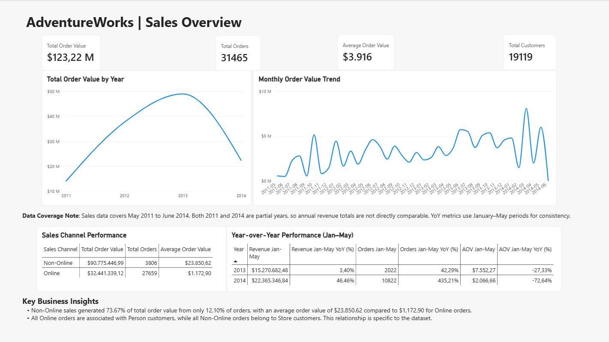
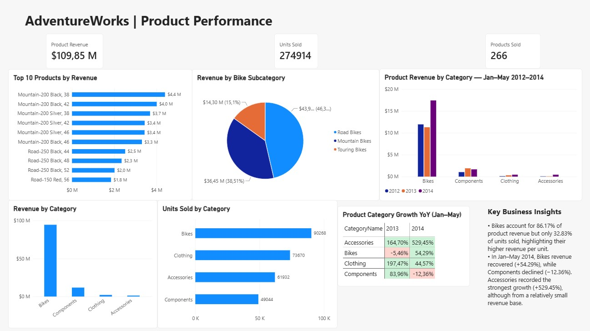
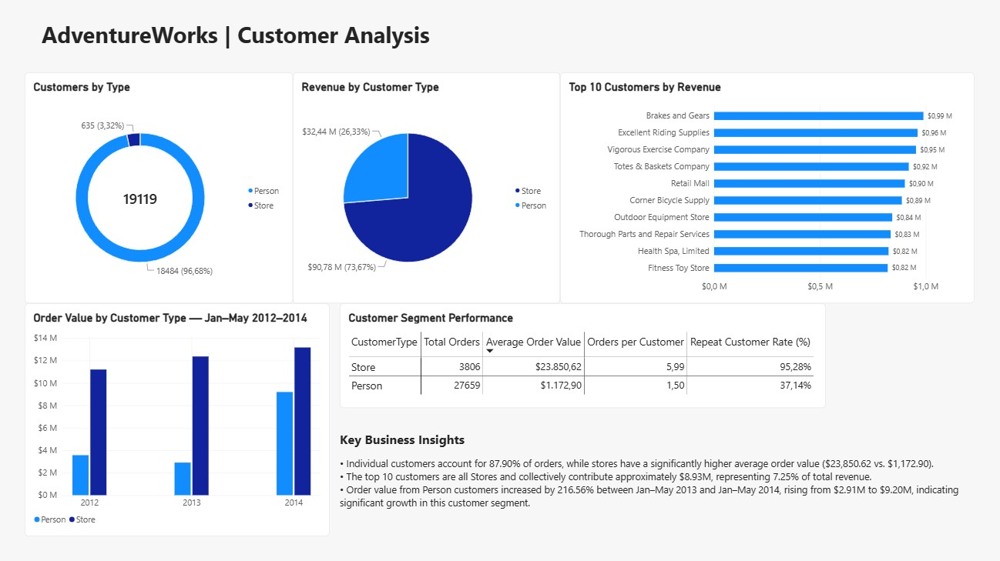
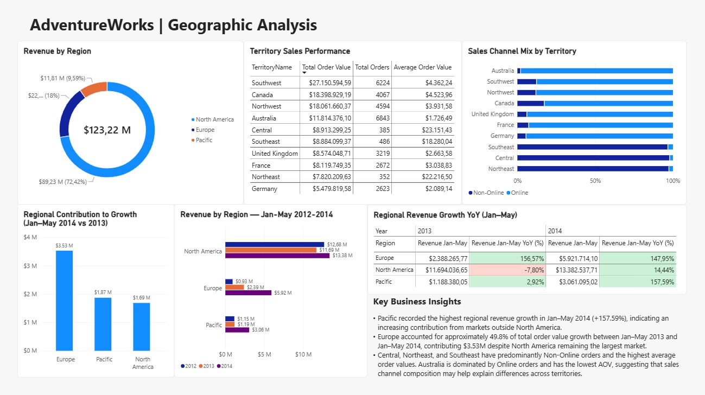
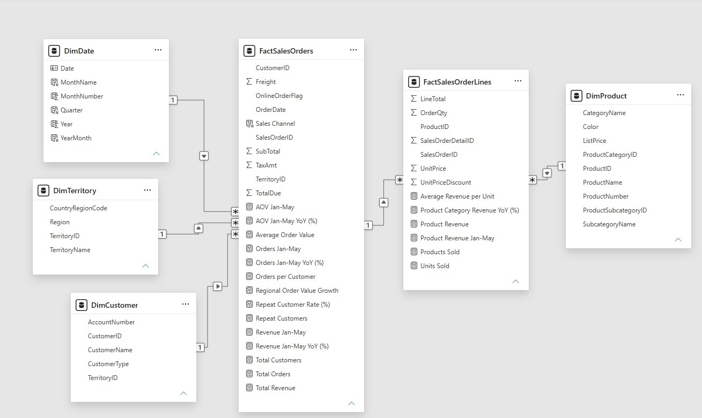

# 📊 AdventureWorks Sales Analytics

## Project Overview

AdventureWorks Sales Analytics is an end-to-end data analytics project built using **SQL Server, Python, and Power BI**. Based on the AdventureWorks2022 database, it explores sales trends, product performance, customer behavior, and geographic performance to identify key business insights and support data-driven decision-making.

The project covers the analytical workflow, from SQL-based data exploration and validation to Python analysis, dimensional data modeling, and interactive Power BI reporting. Particular emphasis is placed on **data accuracy, analytical reasoning, and translating findings into actionable business recommendations**.

## Business Objectives

The project aims to answer key business questions:

- How have order values, order volumes, and average order values evolved over time?
- Which products and categories contribute most to sales?
- Which customer segments generate the most value and demonstrate repeat purchasing behavior?
- Which regions and territories drive revenue and contribute to business growth?
- How do sales channels and customer purchasing patterns differ?

## Tools & Technologies

| Technology | Purpose |
|---|---|
| SQL Server | Data exploration, querying, aggregation, and business analysis |
| Python | Exploratory data analysis and validation |
| Pandas | Data manipulation and aggregation |
| Matplotlib | Data visualization |
| Power BI | Interactive dashboards and business reporting |
| Power Query | Data preparation and transformation |
| DAX | Business metrics, KPIs, and time-based calculations |
| Git & GitHub | Version control and project documentation |

## Power BI Dashboard

### 1. Sales Overview

Provides an executive overview of business performance, including total order value, order volume, average order value, active customers, sales trends, year-over-year performance, and sales channel comparisons.

### 2. Product Performance

Analyzes product revenue, units sold, product categories, subcategories, top-performing products, average revenue per unit, and category growth across comparable periods.

### 3. Customer Analysis

Explores customer segmentation, purchase frequency, repeat customer rate, average order value, top customers, and changes in customer segment performance.

### 4. Geographic Analysis

Examines regional and territorial performance, sales channel distribution, average order value, year-over-year growth, and each region's contribution to overall growth.

## Key Business Insights

### Sales Performance

- Total order value reached approximately **$123.22M**, across **31,465 orders** and **19,119 active customers**.
- Between January–May 2013 and January–May 2014, total order value increased by **46.46%**, while order volume grew by **435.21%**.
- Over the same comparable periods, average order value decreased by **72.64%**, indicating a shift toward lower-value orders.

### Product Performance

- **Bikes generated 86.17% of product revenue**, despite accounting for only 32.83% of units sold.
- Road Bikes generated the highest revenue among bike subcategories, while Mountain Bikes achieved the highest average revenue per unit.
- In January–May 2014, Bikes revenue increased by **54.29%**, Components declined by **12.36%**, and Accessories grew by **529.45%** from a relatively small revenue base.

### Customer Analysis

- Store customers represent only **3.32% of active customers** but contribute **73.67% of total order value**.
- Store customers have a substantially higher average order value than Person customers: approximately **$23,850.62 vs. $1,172.90**.
- **95.28% of Store customers** placed multiple orders, compared with **37.14% of Person customers**, within the available data period.
- Order value from Person customers increased by **216.56%** between January–May 2013 and January–May 2014.

### Geographic Performance

- North America generated approximately **72.42% of total order value**, making it the largest regional market.
- Southwest was the highest-value territory, while Central recorded the highest average order value.
- Europe contributed approximately **49.8% of the total order value growth** between January–May 2013 and January–May 2014.
- Differences in sales channel composition across territories were associated with substantial differences in average order value.

## Data Architecture & Data Model

The Power BI report uses a dimensional data model built from the AdventureWorks2022 database, consisting of two fact tables and four dimension tables.

The model supports analysis at both the order and product levels while maintaining consistent relationships and filtering behavior.

### Data Model

### Fact Tables

| Table | Granularity | Purpose |
|---|---|---|
| `FactSalesOrders` | One row per sales order | Order value, order volume, customer analysis and geographic performance |
| `FactSalesOrderLines` | One row per sales order line | Product revenue, quantities sold and product performance |

### Dimension Tables

| Table | Purpose |
|---|---|
| `DimDate` | Date attributes for time-based reporting and YoY analysis |
| `DimCustomer` | Customer information and segmentation |
| `DimTerritory` | Geographic information, including territories and regions |
| `DimProduct` | Product information, categories and subcategories |

### Relationships

The model uses one-to-many relationships with single-direction filtering:

- `DimDate[Date]` → `FactSalesOrders[OrderDate]`
- `DimCustomer[CustomerID]` → `FactSalesOrders[CustomerID]`
- `DimTerritory[TerritoryID]` → `FactSalesOrders[TerritoryID]`
- `FactSalesOrders[SalesOrderID]` → `FactSalesOrderLines[SalesOrderID]`
- `DimProduct[ProductID]` → `FactSalesOrderLines[ProductID]`

A direct relationship between `DimCustomer` and `DimTerritory` was avoided to prevent ambiguous filtering paths.

### Modeling Decisions

**Data Granularity:** Order-level metrics are calculated from `FactSalesOrders`, while product-level metrics use `FactSalesOrderLines`. This preserves the correct aggregation level and avoids double counting order values.

**Date Dimension:** A dedicated `DimDate` table enables consistent time-based filtering, chronological sorting and comparable-period YoY calculations.

**Filter Propagation:** Single-direction relationships provide predictable filtering behavior across the model. Product-level analysis uses Product Revenue rather than incorrectly allocating order-level totals across products.

## Business Recommendations

### 1. Investigate Declining Average Order Value

**Finding:** Between January–May 2013 and January–May 2014, order volume increased significantly faster than total order value, resulting in a substantial decline in Average Order Value.

**Recommendation:** Analyze changes in customer segments, sales channels, and product categories to identify the main contributors to the declining AOV. Distinguish changes in the overall sales mix from changes in purchasing behavior within individual segments.

**Metrics to Monitor:** Average Order Value, Total Orders, Total Order Value, and customer segment contribution.

### 2. Strengthen High-Value Customer Relationships

**Finding:** Store customers account for a small proportion of active customers but generate most of the total order value and demonstrate high repeat purchasing activity.

**Recommendation:** Investigate revenue concentration among high-value Store customers and monitor changes in their purchasing frequency and order value. Additionally, explore opportunities to improve purchase frequency and average order value among Person customers.

**Metrics to Monitor:** Repeat Customer Rate, Orders per Customer, Average Order Value, and revenue concentration among top customers.

### 3. Investigate Regional Growth Opportunities

**Finding:** North America remains the largest market, but Europe contributed approximately 49.8% of total order value growth between January–May 2013 and January–May 2014.

**Recommendation:** Analyze European territories individually to identify the customer segments, sales channels, and product categories driving growth. Assess whether these patterns are consistent before considering targeted commercial initiatives.

**Metrics to Monitor:** Regional Growth Contribution, Total Order Value by Territory, Year-over-Year Growth, and Sales Channel Mix.

## Data Analysis Workflow

### 1. SQL Analysis

Explored the AdventureWorks2022 database and developed SQL queries to analyze:

- Annual and monthly sales performance.
- Revenue by product, category, and subcategory.
- Customer purchasing behavior and revenue contribution.
- Sales performance by region and territory.
- Year-over-year growth using aggregations and SQL window functions.
- Data quality and unusual sales patterns.

### 2. Python Analysis

Used Python and Pandas to investigate and validate the results of the SQL analysis.

The notebook includes descriptive analysis, business-oriented visualizations, comparisons between customer and product segments, and investigation of unusual patterns in the dataset.

### 3. Power BI Development

Built an interactive four-page Power BI report using a relational data model with sales fact tables and supporting customer, product, territory, and date dimensions.

Developed DAX measures for key performance indicators, growth calculations, customer behavior, and product performance.

## Data Quality & Validation

Data quality checks were performed in SQL Server to assess the integrity, completeness, and consistency of the transactional data before using it for business analysis and reporting.

### Order-Level Validation

The `Sales.SalesOrderHeader` table was validated for duplicate order identifiers, missing values in essential fields, and total order value.

| Validation Check | Result |
|---|---:|
| Total Orders | 31,465 |
| Unique Order IDs | 31,465 |
| Missing Required Fields | 0 |

**Findings:**
- Every sales order has a unique `SalesOrderID`.
- No missing values were found in `CustomerID`, `OrderDate`, or `TerritoryID`.

### Order-Line Validation

The `Sales.SalesOrderDetail` table was validated to confirm the uniqueness of order-line identifiers, completeness of essential fields, and consistency of product-level metrics.

| Validation Check | Result |
|---|---:|
| Total Order Lines | 121,317 |
| Unique Order Line IDs | 121,317 |
| Missing Required Fields | 0 |

**Findings:**
- Every order line has a unique `SalesOrderDetailID`.
- No missing values were found in `SalesOrderID`, `ProductID`, or `OrderQty`.

## Key Metrics & Definitions

| Metric | Definition |
|---|---|
| Total Order Value | Sum of `SalesOrderHeader.TotalDue`, which includes products, taxes, and freight |
| Total Orders | Distinct count of sales orders |
| Active Customers | Distinct customers with recorded orders |
| Average Order Value | Total Order Value / Total Orders |
| Product Revenue | Sum of `SalesOrderDetail.LineTotal` |
| Units Sold | Sum of product quantities ordered |
| Orders per Customer | Total Orders / Active Customers |
| Repeat Customer Rate | Percentage of active customers with at least two orders during the analyzed period |
| YoY Growth | Percentage change against the corresponding period in the previous year |

**Important:** Product Revenue and Total Order Value use different accounting scopes and should not be treated as interchangeable measures.

## Data Coverage & Limitations

The dataset contains sales records from **May 31, 2011, through June 30, 2014**.

As 2011 and 2014 are partial years, comparisons of complete annual totals can be misleading. For this reason, selected year-over-year analyses use **January–May periods** to ensure comparability.

A significant change in sales patterns was also identified in June 2014. This was treated as a data observation requiring caution rather than evidence of a confirmed business event.

The analysis is based on historical sample data. Findings should therefore be interpreted within the scope and limitations of the dataset.

## Project Structure

- `sql/` — SQL queries for sales, product, customer, and geographic analysis.
- `python/` — Exploratory data analysis, visualizations, and business insights.
- `powerbi/` — Interactive Power BI dashboard.
- `images/` — Dashboard screenshots and project visualizations.
- `docs/` — Supporting project documentation.